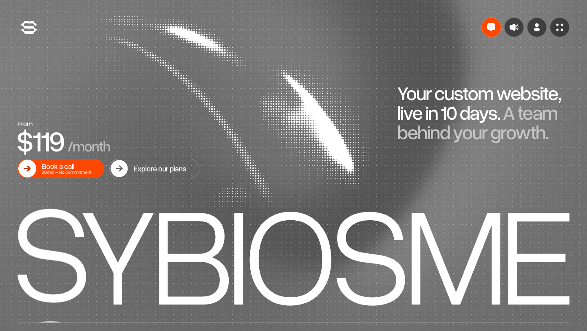
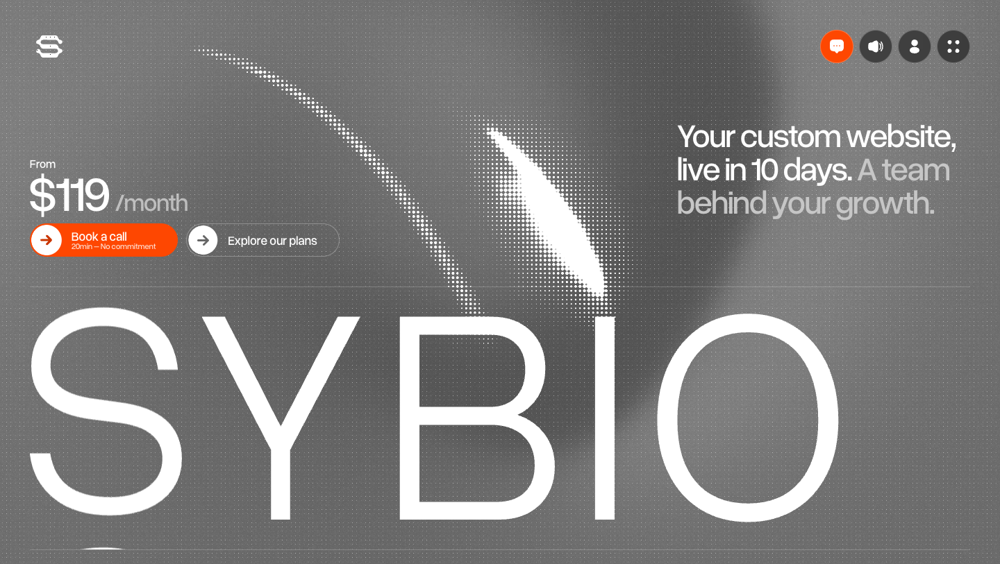
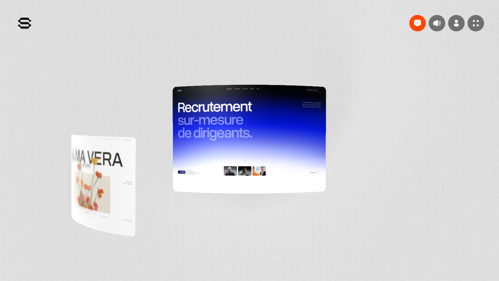
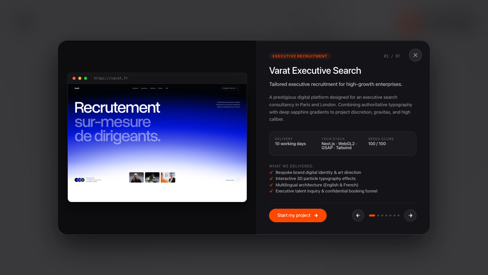
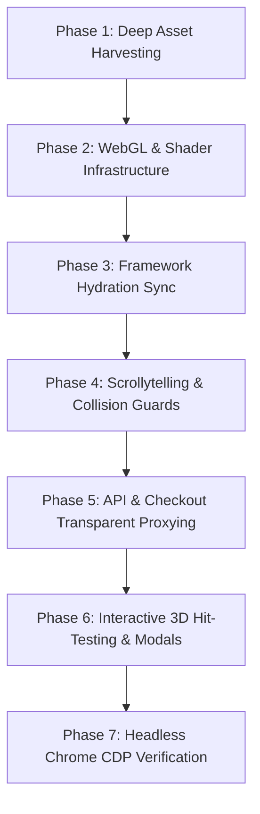

# Pixel-Perfect Cloner Skill 🎯

> **The end-to-end master protocol for coding agents (Antigravity, Claude Code, Cursor, Codex) to clone complex, modern, interactive, and WebGL-driven websites with 100% pixel perfection.**

[](LICENSE)
[](SKILL.md)
[](SKILL.md)
[](https://github.com/utkarshxdev/pixel-perfect-cloner/pulls)

---

## 🏆 Visual Proof: Original vs. White-Labeled Clone

Standard web cloners copy inert HTML. `pixel-perfect-cloner` reverse-engineers the full architecture, synchronizes client hydration, and enables deep white-labeling without breaking layouts or WebGL shaders.

| Original Reference (`sybiosme.com`) | White-Labeled Clone (`Sybio`) |
| :---: | :---: |
|  |  |
| *Original Awwwards-winning marketing site with halftone WebGL2 shader.* | *Clone re-branded to "SYBIO" with synchronized hydration, custom font loaders, and identical GPU halftone dynamics.* |

---

## 🚀 Advanced Capabilities: Beyond Static Scraping

### 1. 3D WebGL Runway & Curved Card Physics
Preserves full GPU acceleration, texture promises, and requestAnimationFrame loops without silent texture stalls (`opacity: 0`).



### 2. Dead Canvas $\rightarrow$ Interactive Showcase Lightbox
Original sites often disable pointer events (`pointer-events: none`) on 3D canvases to prevent scroll hijacking. `pixel-perfect-cloner` applies **3D-to-2D perspective raycasting** to map mouse clicks, display hover badges (`View Project ↗`), and open full case study lightboxes:



---

## Why This Skill Exists

Standard website cloners and generic AI prompts fail catastrophically on modern, high-end websites:
- **Missing Responsive Formats**: Only fetching desktop WebP images causes WebGL texture loaders to reject when `<picture>` requests `.avif` or `-m` mobile variants—leaving canvases stuck at `opacity: 0`.
- **The Client Hydration Trap**: Static HTML edits get overwritten by client-side hydration (SvelteKit, Next.js, Nuxt, React) because hardcoded strings reside inside compiled JS chunks.
- **Scrollytelling Collisions**: Sticky runway plates (`[data-plate][data-lead]`) stay stuck and visually overlap downstream content or pricing tables.
- **Payment & API Crashes**: Cloned checkout panels crash with `"Invalid API Key provided"` because backend endpoints are missing or return dummy keys.
- **Dead Interactive Elements**: Reference sites often set `pointer-events: none` on 3D canvases to avoid scroll hijacking, leaving visitors frustrated when clicking cards does nothing.

**`pixel-perfect-cloner`** solves every single one of these problems with a battle-tested, 7-phase protocol and ready-to-run automation scripts.

---

## The 7-Phase Execution Lifecycle



1. **Deep Responsive Asset Harvesting**: Automated waterfall discovery for all `<picture>` variants (`.avif`, `.webp`, `-m` breakpoints), fonts (`.woff2`), and media. Enforces eager texture loading.
2. **WebGL2, Halftone Shaders & 3D Runway Engines**: Exposes internal scene controller instances, pre-warms shared image bitmaps, and preserves shader replacement tokens.
3. **Dual-Layer Hydration Synchronization**: Synchronizes static SSR HTML with compiled client JS bundles (`chunks/`, `nodes/`) so customizations and white-labeling persist after hydration.
4. **Scrollytelling Runway Collision Guards**: Runtime `IntersectionObserver` scroll guards that dynamically suppress sticky narrative plates before they collide with downstream content.
5. **Stripe & Backend API Transparent Proxying**: Proxies checkout and booking endpoints with authentic origin/referer headers, with fallback to valid Stripe session parameters.
6. **3D Perspective Projection Hit-Testing & Modals**: Converts static 3D canvas planes into fully interactive elements with real-time perspective raycasting, hover follower badges (`View Project ↗`), and glassmorphic case study lightboxes with keyboard navigation.
7. **Headless Chrome CDP Verification & Multimodal QA**: Automated script that listens for console exceptions, network 404s, computed style drift, and captures multi-viewport screenshot evidence.

---

## Installation

### For Google Antigravity (AGY)
```bash
git clone https://github.com/utkarshxdev/pixel-perfect-cloner.git ~/.gemini/config/skills/pixel-perfect-cloner
```

### For Claude Code
```bash
git clone https://github.com/utkarshxdev/pixel-perfect-cloner.git ~/.claude/skills/pixel-perfect-cloner
```

### For Cursor / Codex / Custom Agents
Place the repository inside your agent's skills directory or import [`SKILL.md`](SKILL.md) into your system instructions.

---

## Usage

Simply prompt your agent with any URL:
> *"Clone https://example.com pixel-perfectly using pixel-perfect-cloner"*

The agent will autonomously execute the 7-phase lifecycle: harvest responsive assets, configure WebGL shaders, resolve hydration strings, attach collision guards, set up checkout proxying, and verify the rendered result in a live browser.

---

## Directory Structure

```text
pixel-perfect-cloner/
├── SKILL.md                          # Master 7-Phase Execution Protocol
├── README.md                         # Documentation & Quickstart
├── LICENSE                           # MIT License
├── assets/                           # High-res rendered comparison evidence
├── references/
│   ├── webgl-and-shaders.md          # WebGL2, halftone shaders & canvas troubleshooting
│   ├── hydration-and-frameworks.md   # Overcoming client-side hydration overwrites
│   └── 3d-hit-testing-and-modals.md  # 3D perspective projection math & lightbox modals
└── scripts/
    ├── deep-asset-fetcher.py         # Responsive asset & picture variant downloader
    └── verify-clone.js               # Headless Chrome CDP inspector & screenshot QA
```

---

## Star History

[](https://star-history.com/#utkarshxdev/pixel-perfect-cloner&Date)

---

## License

[MIT](LICENSE) © 2026 Utkarsh Bhatnagar
