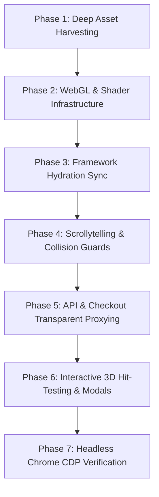

# Pixel-Perfect Website Cloning Master Protocol

This skill provides an exhaustive, battle-tested engineering protocol to reproduce any modern website down to the exact pixel, frame, animation, and backend interaction. It bridges the gap where generic web scrapers fail—handling WebGL2 shaders, responsive asset waterfalls, framework hydration mismatches, scrollytelling runway collisions, live payment APIs, and dead canvas interactivity.

---

## The 7-Phase Execution Lifecycle



---

## Phase 1: Deep Asset Harvesting & Responsive Fallback Mapping

### The Silent Failure Trap
Modern high-end websites do not use simple `` tags. They use nested `<picture>` elements with media queries and modern formats:
```html
<picture>
  <source type="image/avif" media="(max-width: 47.999rem)" srcset="/media/work/1-m.avif" />
  <source type="image/webp" media="(max-width: 47.999rem)" srcset="/media/work/1-m.webp" />
  <source type="image/avif" srcset="/media/work/1.avif" />
  
</picture>
```
If **even one** `.avif` or mobile `-m` variant is missing (returns 404), WebGL texture loaders reject their promises, leaving the 3D gallery canvas stuck at `opacity: 0` and poster elements hidden (`visibility: hidden`).

### Mandatory Action Checklist:
1. **Extract Every URL Variant**:
   Run the deep asset fetcher script (`scripts/deep-asset-fetcher.py`) or inspect the DOM for:
   - Base files: `.webp`, `.png`, `.jpg`, `.svg`
   - Next-gen files: `.avif`
   - Responsive breakpoints: `-m.avif`, `-m.webp`, `@2x.png`
   - Custom fonts: `.woff2`, `.woff`, `.ttf`
   - Shaders and pre-warmed blobs: `hero-sphere.avif`, `audio/tick.mp3`
2. **Force Eager Decoding on Canvas Inputs**:
   Change `loading="lazy"` to `loading="eager"` on any image referenced by a WebGL/Canvas runner (`data-gallery-print`, etc.) so offscreen/hidden DOM elements decode immediately.
3. **Verify Zero 404s in Console**:
   Check server logs or Chrome CDP network requests. Any missing asset (e.g. `NotFound.css`) can trip error boundaries and halt hydration.

---

## Phase 2: Modern WebGL, Shaders & 3D Runway Engines

High-end sites (Awwwards/FWA grade) drive user experience through GPU-accelerated canvases: halftone dot screens, 3D card reels, particle spheres, and distortion lenses.

### Key Rules for WebGL Cloning:
1. **Expose Internal Engine State**:
   Locate where the 3D scene engine initializes in the vendor chunks (e.g., `ee = new Vi(...)`). Expose the instance and canvas globally for hit-testing and debugging:
   ```javascript
   ee = new Vi(...);
   window.__sybiosGallery = ee;
   window.__sybiosGalleryCanvas = K;
   ```
2. **Pre-warmed Asset Sharing**:
   If the original site pre-loads a texture blob before first paint (e.g., `window.__heroSheet = fetch(...).then(r => r.blob())`), mirror this in `public/boot.js` before bundle execution to prevent double transfers or WebGL texture stalls.
3. **Preserve Shader Replacement Tokens**:
   Inspect vendor JS for GLSL string substitutions (e.g., `Ps.replace("SYBIOSME_SOURCE_DISPATCH", t)`). Do not alter internal shader tokens during brand renames.

---

## Phase 3: The Framework Hydration Trap & Dual-Layer Updating

### The Dual-Layer Dilemma
When cloning sites built with SvelteKit, Next.js, Nuxt, or React:
- Modifying static HTML alone is **insufficient**.
- Upon page load, client-side hydration (`kit.start`, `ReactDOM.hydrateRoot`) executes and **overwrites** the DOM with strings hardcoded in the compiled JS chunks (`_app/immutable/chunks/`, `_next/static/chunks/`).

### How to Achieve Complete White-Labeling:
1. **Locate the Brand Configuration Chunk**:
   Search compiled JS files for `wordmark:` or `name:`. You will find the central dictionary (e.g. `const t = { name: "...", wordmark: "...", url: "..." }`).
2. **Update Both Layers in Sync**:
   - Layer A (SSR / Static HTML): Update `<title>`, `<meta>`, Schema JSON-LD, and SSR HTML nodes in `site.html`.
   - Layer B (Client Hydration): Update the brand config chunk (`DgSc1RL4.js`), the translation bundles (`DN_BB8Sr.js`, `CNg8u8nT.js`), and component nodes (`11.BGyOvT1u.js`).
3. **Watch the Font Loader**:
   Check if the site runs `document.fonts.load('... "Overused Grotesk"', "ORIGINAL_NAME")` to measure letter widths. Update the sample string to your new brand name.

---

## Phase 4: Scrollytelling Runways & Collision Guards

### The Runway Overlap Bug
In complex scrollytelling websites, sticky headers, animated hero typography, or runway plates (`[data-plate][data-lead]`) often get stuck on screen when scrolling into downstream content, visually overlapping cards or pricing tables.

### The Runtime Guard Pattern:
Add an active scroll guard in `public/boot.js` using `IntersectionObserver` and capturing scroll listeners:
```javascript
(() => {
  const updateGuard = () => {
    const lead = document.querySelector("[data-plate][data-lead]");
    const target = document.querySelector(".subscription") || document.querySelector("#pricing");
    if (!lead || !target) return;
    
    const rect = target.getBoundingClientRect();
    if (rect.top < window.innerHeight + 50) {
      lead.style.setProperty("visibility", "hidden", "important");
      lead.style.setProperty("opacity", "0", "important");
      lead.style.setProperty("pointer-events", "none", "important");
    } else {
      lead.style.removeProperty("visibility");
      lead.style.removeProperty("opacity");
      lead.style.removeProperty("pointer-events");
    }
  };

  window.addEventListener("scroll", updateGuard, { capture: true, passive: true });
  const observer = new IntersectionObserver(updateGuard, {
    threshold: [0, 0.05, 0.1, 0.5, 1.0],
    rootMargin: "100px 0px 0px 0px"
  });
  const sub = document.querySelector(".subscription");
  if (sub) observer.observe(sub);
})();
```

### The Tailwind Arbitrary Class Trap
Changing an arbitrary class like `text-[25.4942cqw]` to `text-[33cqw]` fails if the build didn't pre-compile `.text-\[33cqw\]`.
**Always** inject an explicit CSS override:
```css
.wordmark-face {
  font-size: 33.2cqw !important;
  letter-spacing: 0.04em !important;
}
```

---

## Phase 5: Stripe & Backend API Transparent Proxying

### Eliminating `"Invalid API Key provided: pk_test_..."`
Cloned sites often fail when interacting with checkout panels because backend endpoints (`/api/checkout`, `/api/booking`) return dummy credentials or 404.

### Transparent Proxy Architecture (`src/app/api/checkout/route.ts`):
1. **Transparent Proxy to Live Origin**:
   Forward the incoming request to the live reference origin with matching headers (`Referer`, `Origin`, `x-locale`).
2. **Graceful Fallback**:
   If live proxying is blocked or offline, supply a valid Stripe session object with real live/test keys, accurate minor unit amounts (e.g. `11900` for `$119.00`), and supported payment methods (`["card", "link", "paypal"]`).

```typescript
import { NextResponse } from "next/server";

export async function POST(req: Request) {
  const body = await req.json();
  const currency = (body.currency || "usd").toLowerCase();
  const plan = body.selection?.plan || "presence";
  const amount = plan === "partenaire" ? 32900 : plan === "croissance" ? 19900 : 11900;

  try {
    const liveRes = await fetch("https://original-site.com/api/checkout", {
      method: "POST",
      headers: {
        "Content-Type": "application/json",
        "Referer": "https://original-site.com/en",
        "Origin": "https://original-site.com",
      },
      body: JSON.stringify(body),
    });
    if (liveRes.ok) return NextResponse.json(await liveRes.json());
  } catch {}

  return NextResponse.json({
    orderId: body.requestId || "order_fallback_id",
    clientSecret: "cs_live_...",
    publishableKey: "pk_live_...",
    amount,
    currency,
    paymentMethods: ["card", "link", "paypal"],
  });
}
```

---

## Phase 6: Transforming Dead Showcase Elements into Interactive Experiences

### The Problem with Original 3D Galleries
Reference sites often use `pointer-events: none` on 3D canvas sections to prevent touch hijacking, leaving visitors frustrated when clicking cards does nothing.

### Solution: 3D-to-2D Perspective Projection Hit-Testing
Map the 3D card meshes to 2D screen coordinates in real time:

$$\text{camZ} = \text{camera.z} - z$$

$$\text{halfHeight} = \tan\left(\frac{\text{FOV} \cdot \pi}{360}\right) \cdot \text{camZ}, \quad \text{halfWidth} = \text{halfHeight} \cdot \text{aspect}$$

$$\text{ndcX} = \frac{x}{\text{halfWidth}}, \quad \text{ndcY} = \frac{y}{\text{halfHeight}}$$

$$\text{screenX} = (\text{ndcX} \cdot 0.5 + 0.5) \cdot \text{canvasWidth} + \text{canvasLeft}$$

$$\text{screenY} = (-\text{ndcY} \cdot 0.5 + 0.5) \cdot \text{canvasHeight} + \text{canvasTop}$$

### The Showcase Lightbox Modal Pattern (`public/work-modal.js`):
1. **Pointer Events**: Enable `pointer-events: auto !important` on canvas.
2. **Hover Follower**: Render a floating glassmorphic pill badge (`View Project ↗`) following cursor coordinates when hovering any card.
3. **Interactive Modal**:
   - macOS browser chrome with live domain URL.
   - High-res project mockup with subtle scale hover.
   - Specs grid (Turnaround, Stack, Performance Score).
   - Deliverables checklist.
   - High-converting CTA (`"Start a project like this"`) that scrolls directly to `#pricing`.
   - Full keyboard accessibility (`Esc`, `ArrowLeft`, `ArrowRight`).

---

## Phase 7: Headless Chrome CDP Verification & Multimodal QA

**Never conclude a clone without real browser verification.** Use Chrome DevTools Protocol to inspect live behavior and take targeted screenshots.

```javascript
// Run via node headless chrome
const version = await getJson("http://127.0.0.1:9222/json/version");
const ws = new WebSocket(version.webSocketDebuggerUrl);
// 1. Check computed styles
// 2. Measure DOM elements & text offsets
// 3. Scroll into sections and capture screenshots
// 4. Inspect captured PNGs with read_file tool
```

### Multimodal QA Checklist:
- [ ] **Hero Section**: Wordmark size, character spacing, halftone contrast.
- [ ] **Navigation & Menus**: Sticky transitions, language/currency drawer.
- [ ] **3D / Canvas**: WebGL renders without black screen or context loss.
- [ ] **Interactivity**: Clicking cards opens lightbox modal; clicking CTA navigates to pricing.
- [ ] **Form & Stripe**: Inputs render cleanly without red "Invalid API Key" warnings.
- [ ] **Mobile & Fallback**: Responsive grid displays cleanly when WebGL is inactive.
